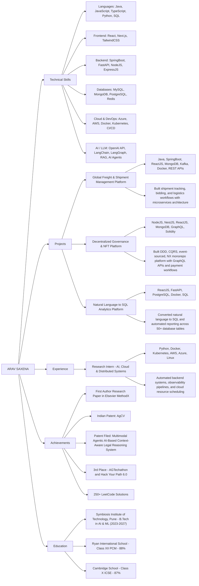

# ARAV SAXENA

Pune, India

aravsaxena884@gmail.com | +919653413126

[LinkedIn](https://linkedin.com/in/arav-saxena-a081a428a) | [GitHub](https://github.com/arav7781) | [LeetCode](https://leetcode.com/u/arav_7782/)

## Profile Summary

software engineer and full-stack developer focused on scalable systems, intelligent applications, cloud-native engineering, and agentic AI. My work combines backend architecture, modern frontend experience, and applied LLM workflows across enterprise and research-driven projects.

## Technical Skills

### Languages
Java, JavaScript, TypeScript, Python, SQL, Shell Scripting

### Frontend
ReactJS, Next.js, HTML5, CSS3, TypeScript, TailwindCSS, Responsive Web Applications

### Backend
NodeJS, ExpressJS, SpringBoot, FastAPI, RESTful Web Services, Microservices

### Databases
MySQL, MongoDB, PostgreSQL, Redis, SQL, NoSQL

### Cloud & DevOps
Azure, Azure DevOps, AWS, Docker, Kubernetes, Linux, CI/CD

### Tools
Git, GitHub, Postman, Swagger, Kafka, NX Monorepo, Cron Jobs, AWS EventBridge Scheduler

### AI / LLM
OpenAI API, LangChain, LangGraph, RAG, AI Agents

### Core CS
Data Structures, Algorithms, OOP, DBMS, Operating Systems, Computer Networks, Software Engineering, Testing

## Knowledge Graph of Works



## Project Portfolio

### 1. Global Freight & Shipment Management Platform
- Tech: Java, SpringBoot, ReactJS, MongoDB, Kafka, Docker, REST APIs
- Built shipment tracking, bidding, and logistics workflows using microservices architecture
- Developed scalable RESTful web services with SpringBoot and MongoDB for distributed operations
- Implemented event sourcing, Kafka messaging, caching, deployment pipelines, and system monitoring
- Timeline: 2024–2025

### 2. Decentralized Governance & NFT Platform
- Tech: NodeJS, NestJS, ReactJS, MongoDB, GraphQL, Solidity
- Developed secure full-stack platform using DDD, CQRS, event sourcing, and NX Monorepo
- Built GraphQL APIs, subscriptions, payment workflows, and responsive web interfaces
- Integrated Stripe, Coinbase, BitPay, and custom ERC721 smart contracts for ownership validation
- Timeline: 2021–Present

### 3. Natural Language to SQL Analytics Platform (Intern Project)
- Tech: ReactJS, FastAPI, PostgreSQL, Docker, SQL
- Built a full-stack analytics platform that converts natural language requests into SQL queries
- Developed API-driven workflows, dashboards, authentication, and database integration
- Automated reporting across 50+ database tables while improving query performance by 35%
- Timeline: 2026
- Organization: CDAC Pune

## Experience

### Research Intern – AI, Cloud & Distributed Systems
- Duration: Jul 2025 – Present
- Organization: Symbiosis Centre for Applied AI (SCAAI), Pune
- Developed scalable backend automation systems and monitoring pipelines using Python, reducing manual operational effort by 60%
- Built APIs, centralized logging workflows, and observability systems enabling analysis of 10,000+ application events daily
- Automated cloud resource scheduling using Shell Scripting, Cron Jobs, and AWS EventBridge Scheduler, reducing infrastructure costs by 30%
- Worked with Docker, Kubernetes, AWS, Azure, and Linux to improve deployment reliability and backend scalability across environments

## Achievements

- First Author Research Paper Published in Elsevier MethodX: DOI Link
- Patent Published: AgCV: An Agentic Framework for Automating Computer Vision Applications
- Patent Published: A System and Method for Multimodal Agentic AI-Based Context-Aware Legal Reasoning and Judicial Decision Support
- 3rd Place – AGTechathon (24 hrs)
- Finalist – Parul University Hackathon
- 3rd Place – Hack Your Path 6.0 (24 hrs)
- Finalist – CodeCraze 2.0
- Solved 250+ algorithmic problems on LeetCode

## Education

- Symbiosis Institute of Technology, Pune — B.Tech in Artificial Intelligence and Machine Learning (2023–2027)
- Ryan International School (CBSE) — Class XII – PCM – 88%
- Cambridge School (ICSE) — Class X – 87%

## Repository Notes

This repository is a personal portfolio website with an AI assistant experience. It includes:

- A portfolio landing page showcasing projects, skills, timeline, research, and achievements
- A Groq-powered chat assistant for profile-based Q&A
- API routes for chat

## Quick Start

```bash
npm install
npm run dev
```

If install conflicts appear because of package peer resolutions, use:

```bash
npm install --legacy-peer-deps
```

